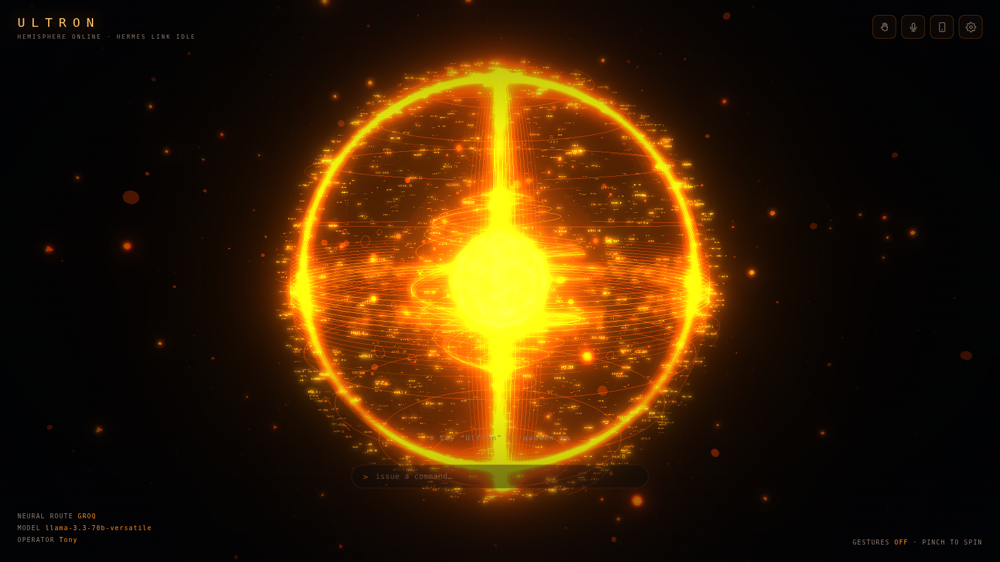

# ULTRON

A fiery holographic AI orb you control with your **hands** and your **voice**. Inspired by [Sagar Tamang's ULTRON](https://github.com/SAGAR-TAMANG/ultron-by-sagar-builds), rebuilt as a full local assistant with:

- 🌌 **Three.js atom orb** — molten core, orbital shells, electrons, drifting code, dust, scan rings, bloom + chromatic aberration
- ✋ **Gesture control** — webcam pinch to spin and zoom (MediaPipe hand tracking)
- 🗣️ **Voice + AI** — wake word, spoken replies, 4 providers (OpenAI, Claude, Gemini, Groq)
- 🧠 **ULTRON database** — a persona/knowledge layer that keeps replies in character
- 📱 **Hermes bridge** — control paired Android devices (tap, screenshot, open apps, SMS, etc.)



## 1. Requirements

- **Node.js 18+**
- A **webcam** (for gestures)
- A **microphone** (for voice)
- Optionally: an **Android phone** + a Hermes relay for device control

## 2. Install & run

```bash
git clone https://github.com/akshitarushtripathy-hub/ultron.git
cd ultron
npm install
npm run dev
```

Open **http://localhost:3000** in Chrome.

For a production build:

```bash
npm run build
npm start
```

## 3. First launch

A popup asks two things:

1. **What should I call you?** — your name (used in replies)
2. **What would you like to call me?** — the assistant name (default `Ultron`)

Click **ESTABLISH LINK**. The name you choose becomes the **wake word**.

## 4. Add an API key (required for AI answers)

Move the mouse to the top-right and click the **⚙** button:

1. Pick a provider: **OpenAI / Claude / Gemini / Groq**
2. Paste the key into **API KEY**
3. Click **SAVE**
4. Pick a model from the **MODEL** dropdown

Get keys here:

| Provider | Link |
| --- | --- |
| OpenAI | https://platform.openai.com/api-keys |
| Claude | https://console.anthropic.com/settings/keys |
| Gemini | https://aistudio.google.com/app/apikey |
| Groq | https://console.groq.com/keys |

Keys are stored in `~/.ultron/config.json` (mode `0600`) and are only sent to the provider you select. Nothing else leaves your machine.

You can also switch provider by voice: _"use groq"_, _"switch to claude"_, etc.

## 5. Controls

### Mouse / touch

| Input | Action |
| --- | --- |
| **Drag** | Spin the orb (damped, smooth OrbitControls) |
| **Scroll / pinch** | Zoom in & out |
| `R` | Reset the view |
| `+` / `-` | Zoom in / out |

### Gestures (webcam)

Click the **✋** button (top-right) and allow camera access. A small mirrored preview with hand landmarks appears in the corner:

| Gesture | Action |
| --- | --- |
| **Pinch** thumb + index on **one** hand, move | Spin the orb |
| **Pinch with both** hands, spread / bring together | Zoom in / out |

The model loads from Google's CDN on first activation, so keep an internet connection handy.

### Voice

Click the **🎤** button (top-right) and allow microphone access, then say the assistant name (e.g. _"Ultron, what time is it?"_). Replies are spoken aloud.

Try:

- _"what time is it"_
- _"open youtube"_
- _"tell me a joke"_
- _"use groq"_
- _"settings"_ / _"open hermes"_
- _"anything else"_ → answered by the AI using the ULTRON database persona

### Typed commands

Type into the bar at the bottom and press **Enter**. Works without a mic.

## 6. Hermes Android bridge (device control)

See **[docs/HERMES.md](docs/HERMES.md)** for the full walkthrough.

Quick version:

1. Install the **Hermes Bridge** accessibility app on your Android phone and grant permissions.
2. Run a Hermes relay (port `8766` by default) reachable by both machines.
3. Pair the phone with the 6-character code.
4. In ULTRON, click the **📱** button, enter the relay URL and pairing code, click **PAIR**.
5. Use the device-tool buttons (ping, screenshot, read screen, open apps, notifications, etc.).

## 7. How it works

| File | Purpose |
| --- | --- |
| `lib/orbScene.ts` | Exact Three.js orb from the public ULTRON interface — layered wireframe shells, geodesic core, drifting code, debris, dust, scan rings, bloom + chromatic aberration, damped OrbitControls |
| `lib/handTracker.ts` | MediaPipe hand landmarks + pinch hysteresis with an on-screen overlay |
| `lib/ai.ts` | Provider-agnostic LLM client (server-side) |
| `lib/ultron-db.ts` | ULTRON persona / system-prompt database |
| `lib/hermes.ts` | Hermes relay WebSocket client + Android tools |
| `lib/config-store.ts` | Local encrypted-ish config at `~/.ultron/config.json` |
| `app/api/*` | Config and chat endpoints (keys stay server-side) |
| `components/Ultron.tsx` | HUD, voice, gestures and panels |

## 8. Notes

- Voice input uses the browser Web Speech API and needs internet.
- Gesture model files load from a CDN on first use.
- WebGL is required; if the orb is blank, enable hardware acceleration in Chrome.
- The Hermes relay protocol is a documented JSON envelope in `lib/hermes.ts` — adjust if your relay differs.

## License

MIT — see [LICENSE](LICENSE).

> This is an independent, from-scratch implementation inspired by the public ULTRON interface concept. It is not affiliated with or endorsed by Sagar Tamang.
